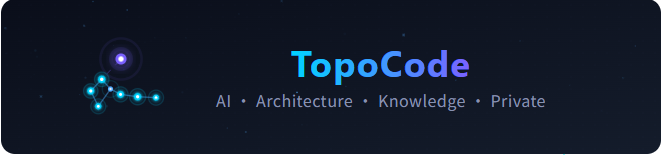

# TopoCode

> **中文** · [中文](README.md)

<p align="center">
  <picture>
    <source srcset="assets/star-logo-en.svg" type="image/svg+xml">
    
  </picture>
</p>

> Source Code Architecture Deep Analysis Tool — An "analysis microscope" for "deep code learning" that elevates your architectural cognition.

TopoCode is not a one-shot efficiency tool that generates architecture diagrams from a single prompt. It is a platform that helps you understand project architecture **layer by layer and improve your architectural cognition**. Through static code parsing, dependency graph computation, community detection algorithms, and AI-assisted analysis, it uncovers the design logic and module relationships behind the code — helping developers truly understand the architecture of unfamiliar projects.

---

> **Privacy Notice**: Except for user-configured cloud LLM APIs, all features of TopoCode — code parsing, graph computing, architecture analysis, web document service, etc. — run **locally**. Your project source code and analysis data are never uploaded to any external server, ensuring your data privacy and security.

## Features

- **Project Import & Management** — Local directory import, file tree browsing, group management
- **Multi-language Code Parsing** — Tree-sitter based AST parsing supporting 18+ programming languages
- **Architecture Visualization** — Dependency/Call/Community structure graphs (D3.js / Cytoscape) with interactive browsing
- **Community Detection** — Louvain / Leiden algorithms for automatic code module (community) identification
- **AI Architecture Analysis** — LLM-powered workflows that automatically analyze component functions and generate architecture overview documents
- **Interactive AI Assistant** — Context-aware Q&A with tool-calling capabilities (symbol search, file reading, etc.), accessible via the local web port in any browser
- **Knowledge Base** — Persistent storage of analysis documents (categorization pending). A key focus for future iterations — the goal is to evolve into an **external brain** that aligns with your cognition. Beyond static storage, it will support multiple integration methods to command other agent tools, closing the loop of **store → analyze → use**
- **Web Document Service & AI Chat** — Local HTTP server (default port 3456) for browsing architecture documents and using the AI assistant in a browser
- **Internationalization** — Chinese / English interface and AI analysis output

> **Note — projects with code generation**: TopoCode parses source files directly from disk and does not require a full build environment. If your project has code generation steps (e.g., protobuf, graphql-codegen, `go generate`, etc.), the generated sources are not part of the original code and won't be included in analysis by default. **For a more comprehensive analysis**, you may run the code generation commands before importing. Analyze based on your needs — covering every generated file is not necessary.
>
> Common code generation command examples:
>
> | Language | Typical Codegen Scenario | May Run Before Import |
> |---|---|---|
> | C / C++ | autoconf config.h / yacc / bison / flex / Qt MOC / protobuf | `./configure` / `bison -d parser.y` / `moc header.h` / `protoc --cpp_out=.` |
> | Go | stringer / mockgen / protobuf | `go generate ./...` / `protoc --go_out=.` |
> | TypeScript | graphql-codegen / protobuf-ts / openapi-generator | `npx graphql-codegen` / `protoc --ts_out=.` |
> | Dart | freezed / json_serializable / drift / protobuf | `dart run build_runner build` / `protoc --dart_out=.` |
> | Java | protobuf / Dagger / MapStruct annotation processors | `protoc --java_out=.` |
> | Kotlin | protobuf / KSP | `protoc --kotlin_out=.` |
> | Swift | protobuf / Sourcery | `protoc --swift_out=.` / `sourcery --sources ...` |
> | C# | protobuf / T4 templates | `protoc --csharp_out=.` |
> | Python | protobuf / Cython | `protoc --python_out=.` |
> | Other | protobuf / thrift / gRPC codegen for any language | Corresponding codegen command |

---

## Tech Stack

| Layer | Technology |
|---|---|
| **Frontend** | Vue 3 + TypeScript + Pinia + Vue Router |
| **UI Styling** | Tailwind CSS + SCSS + Heroicons |
| **Visualization** | D3.js + Cytoscape + Mermaid + PlantUML + PixiJS |
| **Delivery** | Web app (browser via local web service :3456) |
| **Backend** | Python 3.10+ |
| **IPC** | ZeroMQ (pyzmq) |
| **Code Parsing** | Tree-sitter (18+ languages) |
| **Graph Computing** | NetworkX + python-louvain + leidenalg + python-igraph |
| **Web Server** | FastAPI + Uvicorn |
| **AI Inference** | OpenAI / Ollama / LM Studio compatible |
| **Database** | SQLite + DuckDB |

---

## Language Settings

TopoCode supports **Chinese** and **English** interfaces. To switch the language:

1. Open **Settings** (gear icon in the bottom-left corner)
2. Go to **General Settings**
3. Select your preferred language under the **Language** section
4. The interface language updates immediately

The AI analysis output language can be configured independently under **Settings → General Settings → AI Analysis Language**.

---

## Usage Guide

For a detailed walkthrough, please refer to:
- [English Usage Guide](docs/usage-guide-en.md)
- [中文使用教程](docs/usage-guide-zh.md)

---

 ## Project Structure

> Monorepo (npm workspaces + pip editable): 1 core framework + 4 independent sub-projects.

```
topoOne-ui/
├── packages/
│   ├── core/                     # Core framework (topoone-core, editable install)
│   │   └── topoone/
│   │       ├── engine/           # Engine (app/service/task_manager/report_service)
│   │       ├── gateway/          # Gateway (:3456 proxy + RPC routing + auth + SPA static)
│   │       ├── supervisor/       # Process governance (topo serve launches 9 processes)
│   │       ├── rpc/              # ZeroMQ RPC service
│   │       ├── db/               # SQLite multi-database management
│   │       ├── agent/            # AI Agent workflows
│   │       ├── llm/              # LLM inference service
│   │       ├── plugins/          # Core plugins (parsers/community/mcp/runner/llm-provider-*)
│   │       └── manifest.py       # Sub-project manifest-driven registration
│   └── web-core/                 # Frontend shared kernel (@topo/web-core: components/services/portal)
├── apps/                         # 4 independent sub-projects (each: vite app + Python backend package)
│   ├── workbench/                # ① Main workbench (topoone_app_workbench + @topo/app-workbench)
│   ├── docs/                     # ② Doc viewer (topoone_app_docs :3481 + @topo/app-docs)
│   ├── chat/                     # ③ AI chat (topoone_app_chat :3483 + @topo/app-chat)
│   └── architect/                # ④ Architect workbench (topoone_app_architect :3470 + @topo/app-architect)
├── build/                        # Build scripts (bundle-worker/plugin/module)
├── scripts/                      # Dev scripts (serve.sh / setup.sh / rpc-baseline)
└── docs/                         # Engineering conventions (conventions/CONV-00~04) + database design
```

### Sub-Projects

| Sub-project | Frontend | Backend | Port | Responsibility |
|---|---|---|---|---|
| **workbench** | `@topo/app-workbench` | `topoone_app_workbench` | `/app` | Main workbench (import/analysis/visualization/knowledge) |
| **docs** | `@topo/app-docs` | `topoone_app_docs` | `:3481` | Doc viewer (viewer/web-root, render.* RPC) |
| **chat** | `@topo/app-chat` | `topoone_app_chat` | `:3483` | AI chat (sessions/skills/drafts) |
| **architect** | `@topo/app-architect` | `topoone_app_architect` | `:3470` | Architect workbench (semantic assets/requirements/design/Coding Agent) |

> The core framework (`packages/core`) provides the gateway, RPC, DB, Agent, LLM, plugins and process governance; the 4 sub-projects are registered via manifests, run as independent processes, and are launched together by `topo serve` (9 processes).

---

## Recommended Environment

- **CPU**: 4+ cores
- **RAM**: 16 GB or more
- **OS**: Linux / macOS / Windows (physical or VM)
- **Storage**: At least 10 GB free space (for parsed data and knowledge base)

> **Local model hardware requirements**: Running local models like Qwen3.6-9B-Q4 (quantized) requires **NVIDIA RTX 4060 Ti 16 GB or above**. Without a dedicated GPU, local models will fall back to CPU inference, which is significantly slower. If using only cloud models (e.g., DeepSeek V4 Flash), 4-core / 8 GB RAM is sufficient for basic usage.

> **Runtime form**: This is a web app (browser access) with no desktop dependency. It runs directly on servers/VMs/containers without a virtual display (xvfb).

### LLM Analysis Time Estimates

Architecture analysis duration depends on **codebase size**, **LLM performance**, and **concurrency settings**. Typical estimates (single concurrency, 50 tokens/s):

| Phase | Est. Time | Notes |
|---|---|---|
| **Syntax Parsing + Component Relationship Analysis** | 2–5 min | Static analysis, no LLM required |
| **5,000 Source Files Analysis** | 10–20 min | File traversal and basic metadata extraction |
| **File Pre-summary** | ~1 min / file | Hundreds of files may take hours; LLM-intensive |
| **Component Analysis** | 1–5 min / component | Depends on component size, multi-turn LLM dialogue |
| **Overall Architecture Generation** | 1–5 min | Synthesizes summaries into architecture overview |

> **Tip**: Create an account and visit **User Center → Resource Center** to download pre-analyzed architecture content. The resource center is updated regularly with popular projects — saving you local processing time.

## Prerequisites

- **Node.js** >= 20.0.0
- **Python** >= 3.10
- **npm** or **pnpm**
- **pip**

## Quick Start

### 1. One-click Setup

```bash
# Create .venv + pip install -e (core + 4 sub-project backends) + npm install (workspaces)
npm run setup
```

> Manual steps (equivalent to `npm run setup`):
> ```bash
> python3 -m venv .venv && source .venv/bin/activate
> pip install -e packages/core -e apps/workbench -e apps/docs -e apps/chat -e apps/architect
> npm install
> ```

### 2. Run

```bash
# Full-stack dev (core backend + 4 frontend dev servers in parallel)
npm run dev

# Backend services only (supervisor launches 9 processes, :3456)
npm run serve          # equivalent to topo serve

# Check status / stop
npm run status         # equivalent to topo status
bash scripts/serve.sh stop
```

> You can also use the `topo` CLI directly (globally available after install): `topo serve` / `topo status` / `topo doctor` / `topo init`, etc.

A token is generated on first launch (see terminal output). Browser URL: `http://localhost:3456/#token=<token>`

| URL | Description |
|---|---|
| `/` · `/home` | Unified portal home |
| `/app` | Main workbench (workbench) |
| `/projects` · `/viewer` · `/web-root` | Doc viewer (docs) |
| `/chat` | AI chat (chat) |
| `/architect` | Architect workbench (architect) |

### 3. Build

```bash
# core bundle (worker/plugin/module) + portal + 4 sub-project frontends
npm run build
```

---

## LLM Configuration

After launching, go to **Settings → Model Config** to add an LLM model. Any provider compatible with the OpenAI API format is supported.

### Model Recommendations

| Purpose | Recommendation | Notes |
|---|---|---|
| **Architecture Analysis (Agent Workflow)** | Local model: Qwen3.6-9B or above (Ollama / LM Studio) | Architecture analysis consumes significant tokens due to multi-turn tool calls and file summarization. **Local deployment recommended** for cost savings and response speed |
| **AI Chat** | Cloud model, e.g. **DeepSeek V4 Flash** | Interactive chat benefits from stronger models. DeepSeek V4 Flash offers excellent value. GPT-4o / Claude also supported |

### Common Configurations

- **Ollama (local)**: `http://localhost:11434`
- **OpenAI-protocol compatible** (any service supporting the OpenAI API format, e.g. DeepSeek, Qwen, etc.): `https://api.openai.com`
- **DeepSeek**: `https://api.deepseek.com`
- **LM Studio**: `http://localhost:1234`

---

## Web Service & AI Chat

When the application is running, **all interfaces are served through the local web service**, which listens on `http://localhost:3456` by default (URL layout see the "Run" table above). The HTTP port and bind address can be changed in **Settings → General Settings**.

### PlantUML Rendering Service

PlantUML diagrams in Web documents and AI chat require a rendering service. **It is recommended to deploy a local PlantUML service** to ensure data security, response speed, and stability.

The frontend sends diagram source to the backend proxy (`POST /api/plantuml`) which encodes and forwards to the PlantUML server — no URL length limits.

Deploy with Docker (use a mirror registry in China for faster downloads):

```bash
# Docker Hub with Alibaba Cloud mirror (recommended for China)
docker run -d --name plantuml -p 8300:8080 registry.cn-hangzhou.aliyuncs.com/dockerhub-mirror/plantuml/plantuml-server:jetty

# Official image
docker run -d --name plantuml -p 8300:8080 plantuml/plantuml-server:jetty
```

Set the backend environment variable (in `docker-compose.yml` or systemd):

```bash
PLANTUML_SERVER=http://localhost:8300
```

Default is `http://www.plantuml.com/plantuml` — must be changed for internal networks.

Restart the Python backend after changing.

### MCP Server

Provides a Model Context Protocol (HTTP) interface for external agents/tools. It runs as an independent process on `:3460`, and tool calls are forwarded to the architect service (`:3470`).

```bash
# Standalone start (topo serve auto-launches it as one of the 9 processes; usually no manual start needed)
python -m topoone.plugins.mcp
```

External agent endpoints:

| Endpoint | Description |
|---|---|
| `GET http://localhost:3460/v1/tools` | List available tools (arch.read / arch.write / arch.invoke / arch.status) |
| `POST http://localhost:3460/v1/tools/{tool_name}/call` | Execute a tool call (forwarded to architect) |

> MCP integration path change (split M08): changed from the old `python plugins/mcp_server/server.py` to `python -m topoone.plugins.mcp`. Clients use HTTP mode (not stdio) and only need to point their integration URL to `http://localhost:3460`.

### All Config Options

| Variable | Description | Default |
|----------|-------------|---------|
| `VITE_API_BASE` | API base URL (nginx proxy to backend) | `https://topocode.cn` |
| `VITE_DISABLE_MOCK` | Disable mock data | `true` |

---

## Development

> **Module ownership & boundary conventions** (read before developing a subsystem/sub-module): `docs/conventions/`
> CONV-00 Overview & ownership matrix / CONV-01 Core framework / CONV-02 Frontend shared kernel / CONV-03 Sub-project conventions (incl. new sub-project template) / CONV-04 API contracts & acceptance gates

```bash
# Code quality
npm run type-check    # TypeScript type checking (all workspaces)
npm run lint          # ESLint code style

# Tests
npm run test          # Backend pytest (core + 4 sub-projects) + frontend vitest (workbench + web-core)
npm run test:py       # Backend only
npm run test:fe       # Frontend only

# Single sub-project (examples)
npm run dev -w @topo/app-architect    # architect frontend dev
npm run build -w @topo/app-docs       # docs frontend build
python -m pytest apps/architect/tests # architect backend tests
```

---

## License

[Apache License 2.0](LICENSE)

---

## Contact

- Developer Email: **topocode@163.com**
- Project Homepage: [https://github.com/topocode/topoone-ui](https://github.com/topocode/topoone-ui)
- Issues: [https://github.com/topocode/topoone-ui/issues](https://github.com/topocode/topoone-ui/issues)
