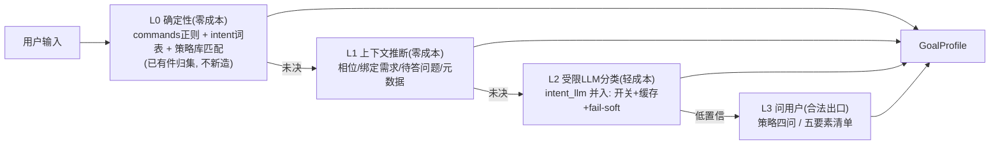

# 目标理解层(GU) — cv-217 排查记录 · 现状机制盘点 · 归一设计(v0 讨论稿)

> 日期：2026-09-22 · 性质：排查记录 + 机制盘点 + 设计讨论稿（未定稿）
> 触发：cv-217(topo-animation) 未走需求分析路线的用户观感排查；用户裁决方向：对话逻辑太僵硬，修复不从加规则入手，先缩小范围到「目标理解」加深加细。
> 关联：`agent-arch-gap-adoption-2609.md`(架构采纳单源) · `tech-debt-ledger-2609.md`(A1/D5 挂账) · `agent-session-flow.md`(全景图)

---

## 一、cv-217 排查记录(事实闭环)

### 1.1 事实链

| 环节 | 事实 | 证据 |
|---|---|---|
| 入口 | kind=generic 普通会话 | arch_conversations |
| 输入 | 项目定位长描述 + 「先构建开发环境」 | 消息流 09:26:09 |
| KB | 未关联基线(degraded=true, baselineId=null) → kb 工具全关 | tool_call project.ctx |
| 澄清 | clarify_mode=auto + 无绑定需求 → directive 空串 | cv-190 空态逻辑 |
| 实际 | 模型直调 task.propose → task-33 → free→armed；req.propose 零调用 | tool_call/outbound_route/flow_drift |
| 对照 | RQ-133~135(同类诉求)走完整需求路线，但入口=asset-chat(source_type 字段) | arch_requirements |

### 1.2 根因：三道门叠加锁死目标理解

1. **人格门(教学冲突)**：每回合同时注入两套 system 教学——能力文档(prompt.py)教「需求分析 agent：开发类需求必须先 req.propose」，路由段(turns/context.py 工作模式消息)教「外循环编排者：能动手的→task.propose(示例字面含『检测编译环境』)」。冲突时模型按关键词具体性站队，「构建开发环境」字面命中路由段示例。
2. **模式门(引擎死路)**：clarify 引擎 auto 模式 + 无绑定需求 → **返回空串**。「先理解再产出」只有 forced 模式才有——默认形态下架构上不存在立卡前的理解阶段。
3. **入口门(知识锁死)**：策略库 STRATEGIES 首条即 `env_setup`「开发环境搭建」(关键词 环境/搭建/安装/编译/构建/依赖…，配好四问)，且 `is_explicit_instruction("搭建开发环境")=False`(注释自认开放式目标)——但 `match_strategy` 只在 forced 分支可达。**正确的目标理解知识成为死代码路径**。

放大器：KB degraded 弱化分析面；默认保存裁决(cv-188)降低建卡摩擦。
排除项：P0/P1 新机制(intent 兜底缺省关/相位硬闸 free 未命中/P 轴 free 无注记)均未参与；T2 门禁是 R3.2 逻辑图门禁与需求路线无关。

### 1.3 修复方向记录(F 组, 待拍板)

| 方向 | 内容 | 性质 |
|---|---|---|
| F1 人格统一 | 能力文档与路由段合并单一身份；教学与决策同源 | 提示面重构 |
| F2 关键词闭集→性质判据 | 三问判据(反复使用/多步/验收→需求；单命令→任务卡；拿不准→先问) | 替换规则为判断 |
| F3 澄清前置 | auto+无需求+开发类诉求 → 允许先问再立卡 | 引擎解锁 |

---

## 二、现状盘点：「目标理解」当前的完整处理机制

按回合管线顺序，凡参与「理解用户想要什么」的既有机制全表：

| # | 机制 | 位置 | 触发 | 产物 | 状态评估 |
|---|---|---|---|---|---|
| 1 | 指令/确认直通 | perception/commands | 整条消息恰为指令/确认语(正则) | 确定性执行 | ✅ 保留(不可逆动作保护) |
| 2 | 收件人路由 | orchestrator._chat_route | attachTo/@ 元数据 | transfer/assign/chat | ✅ 元数据驱动, 非目标理解 |
| 3 | 相位硬闸 | governance/flow | interrupted×下发意图(正则) | 直通回执 | ✅ 状态×意图冲突检查, 保留 |
| 4 | 意图正则 | perception/intent | GENERIC_EXEC/DEFLECT 词表 | 守卫词/纠偏面 | ⚠️ 词表法, 边界失准 |
| 5 | LLM 意图兜底 | turns/intent_llm | 开关(缺省关)+正则未命中 | 软提示 | 🆕 P1 已建, 待 A1 拍板 |
| 6 | 路由系统段 | turns/context.py 工作模式消息 | 每回合 | 关键词闭集教学 | ❌ 与 7 冲突, 僵硬主源 |
| 7 | 能力文档 | cognition/prompt.py | 每回合 | 需求分析人格+边界+工具教学 | ⚠️ 与 6 冲突 |
| 8 | 澄清引擎 | requirements/clarify.py | 仅 forced 无需求 / 有需求缺口 | 四问/缺口问题 | ❌ auto+无需求=死路 |
| 9 | 目标策略库 | clarify.py STRATEGIES(7类×4问) | match_strategy 仅在 8 的 forced 分支 | 目标要素问题集 | ❌ 知识被锁(死代码路径); D5 挂账配置化 |
| 10 | 需求收集管线 | requirements/harness | asset-chat 等场景入口 | 深度收集 | ⚠️ 场景限定, 未归一 |
| 11 | 要素框架提示(U轴) | compensation.providers | A 轴弱时 | 要素清单引导 | ✅ 可复用 |

### 2.1 归一视角的五个缺陷

1. **无统一理解产物**：11 处机制各猜各的，产物形态互不相通(布尔命中/提示文案/问题集)，无共享契约。
2. **决策散落三处**：代码直通(1/3)、提示面教学(6/7)、引擎分支(8/9)——没有单一决策点，无法回答「本回合为什么走了这条路线」。
3. **理解知识与决策门耦合**：策略库(知识)被 mode 分支(门)锁死——知识是对的, 门是窄的。
4. **双重人格教学冲突**：模型姿态不稳定, 只能关键词站队。
5. **要素词表其实已有**：D10 五要素(目标/方案要点/允许范围/禁止改动/验收)贯穿 clarify 策略 questions 与 U 轴清单, 但没有任何机制用它度量「理解是否完整」。

---

## 三、归一设计(v0 讨论稿)：目标理解层 GU

### 3.1 设计主张

- **回答前置问题**：最前置的应是「确定性指令识别」(已存在, 不可逆动作保护, 不动)；紧随其后的才是 GU——对**其余一切输入**(新会话/续接/答问)统一产出理解, 再交决策。
- **理解是梯度, 不是单点**：简单 case 零成本(正则/上下文), 边界 case 才升级(LLM/问用户)。问用户是合法出口, 不是失败。
- **依据规则推展, 非硬编码**：理解器(怎么判断)是代码单源(确定性可测试); 决策(判断完走哪)与文案(怎么说)与策略集(问什么)走 policy 配置——延续 agent.flow.policy 的「缺省+深合并+校验+fail-soft」基座。

### 3.2 GoalProfile——统一理解产物(契约草案)

```jsonc
{
  "kind": "command | requirement | operation | inquiry | continuation",
  "target": "new | <reqId> | <taskId>",      // 续接既有 or 新目标
  "elements": {"目标": 1, "方案要点": 0, "允许范围": 0, "禁止改动": 1, "验收": 0},  // D10 词表复用
  "elementsScore": 0.4,                       // 完备度
  "strategy": "env_setup | null",             // 命中的澄清策略(策略库键)
  "conflict": null,                           // 与相位/绑定需求的状态冲突(复用守卫)
  "confidence": 0.0,
  "sources": ["regex", "context"]             // 理解来源(可追溯)
}
```

### 3.3 理解器梯度(代码单源, 逐级升级)



### 3.4 决策面——规则表驱动(policy 配置, 非硬编码)

```jsonc
// agent.flow.policy 扩展顶层键 "goal"(缺省+深合并+写侧校验同款基座)
"goal": {
  "decision": [
    {"when": {"kind": "command"},        "then": "passthrough"},
    {"when": {"kind": "requirement", "elementsScore>": 0.6}, "then": "req.propose"},
    {"when": {"kind": "requirement"},    "then": "clarify-first", "with": "strategy"},
    {"when": {"kind": "operation"},      "then": "task.propose"},
    {"when": {"kind": "inquiry"},        "then": "answer"},
    {"when": {"confidence<": 0.5},       "then": "ask-one-question"}
  ],
  "escalation": {"llmFallback": false, "minConfidence": 0.5},
  "texts": {"clarifyFirst": "…", "askOne": "…"}   // 文案键, 实文经 providers 单源
}
```

- 决策表**顺序匹配**首中即停；写侧校验(kind 词表/动作词表/阈值钳界)复用 flow_policy 校验器。
- then 动作词表是注册制(代码单源执行器), 配置只选择——与守卫意图按名引用同纪律。
- 策略库配置化(D5 顺势偿还)：STRATEGIES 迁 CollabConfigStore, 代码留引擎(match/gap/directive), GU 直接消费配置策略集。

### 3.5 与现有件的关系(不推倒, 归位)

| 现有件 | 归位 |
|---|---|
| 指令/确认直通 + 相位硬闸 | 不动(确定性层, GU 之前) |
| 澄清引擎 match_strategy/gap_matrix | 成为 GU 的 L0 理解器 + L3 问题供给, auto 死路解锁 |
| 路由段 + 能力文档(6/7) | 合并为单一教学, 文案由决策表同源生成(F1)——"教学=决策"消除冲突 |
| intent_llm(P1) | 并入 L2, 开关即 policy.escalation.llmFallback(A1 决策顺延) |
| 相位机 | GU 读相位做 conflict 检查; 硬闸仍只吃确定性意图词(防守线①不变) |
| D10 五要素 | 成为 elements 度量口径(词表已冻结, 零新词表) |

### 3.6 落地切片(草案, 待拍板后细化)

| 切片 | 内容 | 验收 |
|---|---|---|
| GU-0 | 本档讨论定稿(契约/决策表/切片裁决) | 用户拍板 |
| GU-1 | GoalProfile 产出器(L0 归集: 已有件接入, 落遥测 goal_profile 事件) | cv-217 重放: profile.kind=requirement, strategy=env_setup |
| GU-2 | 决策表引擎 + policy.goal 键 + 文案 providers | 规则可配置, 坏值回落缺省 |
| GU-3 | 提示面单源化(双重人格合并) | system 栈唯一身份, 教学=决策表 |
| GU-4 | 澄清前置(auto 解锁) + 策略库配置化(D5 偿还) | auto+无需求+开发类诉求 → 先问后立卡 |
| GU-5 | L2 并入(联动 A1) | 遥测支撑翻开决策 |

---

## 四、待拍板问题(2026-09-22 已裁决)

1. GoalProfile.kind 五分类 → **先这样, 不够再加**。
2. 配置挂载 → **挂现有 `agent.flow.policy` 顶层键 `goal`**(方案 A: 归一, 零新基座; 校验模块化隔离复杂度)。
3. 人格 vs 决策表 → **两层切分**: 人格恒定(能力文档 posture 静态块, 防多轮目标转换的人格抖动); 决策表只生成**回合指引**(动态, 与人格分层)。防污染根本保证: 目标状态存实体(需求行/任务行/相位缓存), 提示词每回合重建不累积。
4. cv-217 task-33 → 用户删除重建, 不作重放用例; GU-1 验收改合成用例。

## 五、实施记录

### GU-1/2/3 已落地(2026-09-22, 批甲; 938 tests + 棘轮 + vue-tsc 绿)

| 件 | 落点 |
|---|---|
| GoalProfile 产出器 | `agent/turns/goal.py::build_goal_profile`(L0 指令/显式指令/策略库/意图词表 + L1 绑定需求/相位冲突; 边界撞车按策略记分裁决: 单词撞车→操作, 多词 topical≥2→需求); 遥测 `goal_profile` 事件 |
| 决策表引擎 | `flow_policy.goal`(decision 顺序匹配首中即停, 低置信卫兵前置 + directives 文案模板 + escalation); `resolve_goal_directive`/`apply_goal_directive`(编排接线+遥测, 注入失败回退无指引) |
| 人格统一 | `prompt.py` 新增 posture 静态块(order=6, required, 判据三问/双出口/续接规则/不复述回执); **context.py 路由段(工作模式消息)退役**, 挡位文案(A 轴)保留独立注入; legacy 等价串同步 |
| 排除项 | 指令/确认直通、相位硬闸不动(防守线①); intent_llm 的 intent_hint 调用点由 GU 取代(模块保留, GU-5 并入 L2); misroute 遥测保留 |

已知边界(记录不修): 策略库关键词与执行词表存在语义重叠(如 data_analysis×统计), L0 记分裁决为启发式; 误分类由 clarify-first 的「先问」姿态兜底, GU-5(L2 LLM)进一步收敛。

### GU-4/5 已落地(2026-09-22, 批乙; 943 tests + 棘轮 + vue-tsc 绿)

| 件 | 落点 |
|---|---|
| 澄清前置归位(GU-4) | `clarify_directive` 收敛为**已建需求缺口驱动面**(auto/forced 同款); 立卡前澄清归 GU 决策表(clarify-first 消费策略四问, 编号提问/推断默认值/禁止泛问教学并入指引文案)——auto 死路解锁 |
| 策略库配置化(D5 偿还) | `flow_policy.goal.strategies` 单源(缺省条目拆 `governance/goal_defaults.py` 纯数据模块); `clarify.load_strategies()` 配置加载 + `match_strategy(text, strategies=)` 注入; 写侧校验(key 唯一/questions 二元组/D10 要素词表冻结)——改一条澄清问题 = PUT /flow-policy 零发版 |
| L2 受限分类并入(GU-5) | `intent_llm.classify_intent`(缓存+fail-soft); `build_goal_profile` 在 `goal.escalation.llmFallback`(缺省关)且 L0 无信号时尝试升格 operation; 确定性命中永不被 LLM 改写(防守线①); intent_hint 退役, misroute 遥测保留 |
| 配置面收敛 | overrides 键 `intent_llm_fallback` 废除(被 `goal.escalation.llmFallback` 取代); 顶层键 `intentFallback` 废除(长度/置信门槛并入 escalation) |
| 已知边界 | forced「全量先问」不再引擎级强制——策略命中仍先问(规则), 策略未命中由 posture 判据承担; 需要更硬 forced 可运营配置规则 `{kind:inquiry, clarifyMode:forced}→clarify-first`(when 支持 clarifyMode/explicit 键, 缺省表留注释扩展位) |

### 候选菜单 + L2 上下文已落地(2026-09-22, 批丙; 用户需求对标: ②按需上下文/③多候选决策)

| 件 | 落点 |
|---|---|
| 候选菜单动作 | `GOAL_ACTIONS` += `present-options`(动作 7→8); 决策表缺省规则 `{"when":{"candidates":true},"then":"present-options"}` 置于 ask-one-question 后/clarify-first 前(先定性质再谈澄清); `_when_hit`/写侧校验增 `candidates` 布尔条件键; directives 增 `{options}` 菜单模板(配置化) |
| kind 级候选 | 策略×执行词**独立弱撞**(score<2 ∧ 策略命中词不全被执行词表覆盖 ∧ 构建标记 做/写/开发/封装…) → `_KIND_CANDIDATES`(需求规约 vs 一次性操作); 纯依赖撞车(「统计一下文件数」)与执行框架(「帮我跑个脚本看看」)**维持操作单判**——防菜单滥用回归僵硬(冻结用例保持) |
| 策略级候选 | `clarify.match_strategy_candidates(text, n=2)`(同源记分/稳定排序); 无执行词 ∧ top-2 分差≤1 → 双问题集候选(profile.strategy=首候选, 决策表菜单优先) |
| 收敛回路 | 零新状态——菜单后用户答复由下回合 GU 重判自然收敛(命中策略词→确定性 clarify-first; 未命中→answer 兜底, 指引带「浮现开发类诉求收敛为需求规约」由模型收敛) |
| L2 上下文携带 | `classify_intent(question, context)`(有界 400 字, 并入缓存键); `apply_goal_directive._recent_user_context` 从 msgs 派生最近 2 条用户消息摘要(各 ≤80 字, 排除本回合, 零 store 依赖); `llmFallback` **缺省关不变**; 遥测 `intent_llm.contextChars`/`goal_profile.candidates+contextChars` |
| embedding 分类器 | 评估后**撤销**(收益不足; `intent_misroute` 遥测持续攒数据, 词表+策略+L2 足覆盖高频面) |

已知边界更新: 撞车裁决从「单词撞→操作」进化为三判据(独立词/构建标记/score)——菜单只在真歧义时出现; 强信号裁决面(score≥2→需求, 执行词→操作)冻结不变。

### 提示词减载批丁已落地(2026-09-22; 体检驱动: 静态 9.6K/工具 5K 全量/约束 20+ → 中小模型遵从率劣化)

| 件 | 落点 |
|---|---|
| A 测量面 | `prompt_sections` 遥测(orchestrator, 每回合): systemBase/systemInjections/history/tier/toolSurface/guAction/guTools——「哪层重→哪层失遵」数据闭环, 关联台账 A4 |
| B 工具按需注入 | 决策表 rules 增 `tools` 键(写类限定, 校验+fail-soft)+`goal.toolClasses.read`(fnmatch 读类恒供); `plan_goal_directive`/`inject_goal_directive` 拆分(plan 前置于装配参与渲染); allowed 解析注册表交集(零发版容错); 能力文档子集渲染(5.5K→**1.75K**); structured 轮 schema tool **enum**(约束解码层面收敛); 执行面三分支名单外拒绝回喂(refused 不参与落卡轮判定); run_tools_loop 降级通道同规; `tools=null`(未配置)不限面 vs `[]`(显式只读)语义分界 |
| C 静态面瘦身 | 落卡纪律去重(条 1 与 posture 三问重复→退役, 纪律单源工具面 309→~180 字); 指令符号/边界/范围段压缩; `protocol_doc(slim)`/`prompt_slim`(t2+ 简挡省系统面说明段); 边界段保留「不拒做/designMd」契约关键词(cv-181) |
| 裁决 | legacy 等价断言(逐字节)退役→回退通道可用性断言: 冻结字面量与注册表渲染早已结构性漂移(新工具只入注册表), 字节对齐=B4 迁移窗口后的双源负债 |

效果对账: 本轮路线能力文档 5,584→1,750 字(−69%); 协议段 731→480; 结构化轮 msgs 预计 12.2K→~8.5K(t2 简 挡再降)。后续以 prompt_sections×A4 遵从率数据复核。
