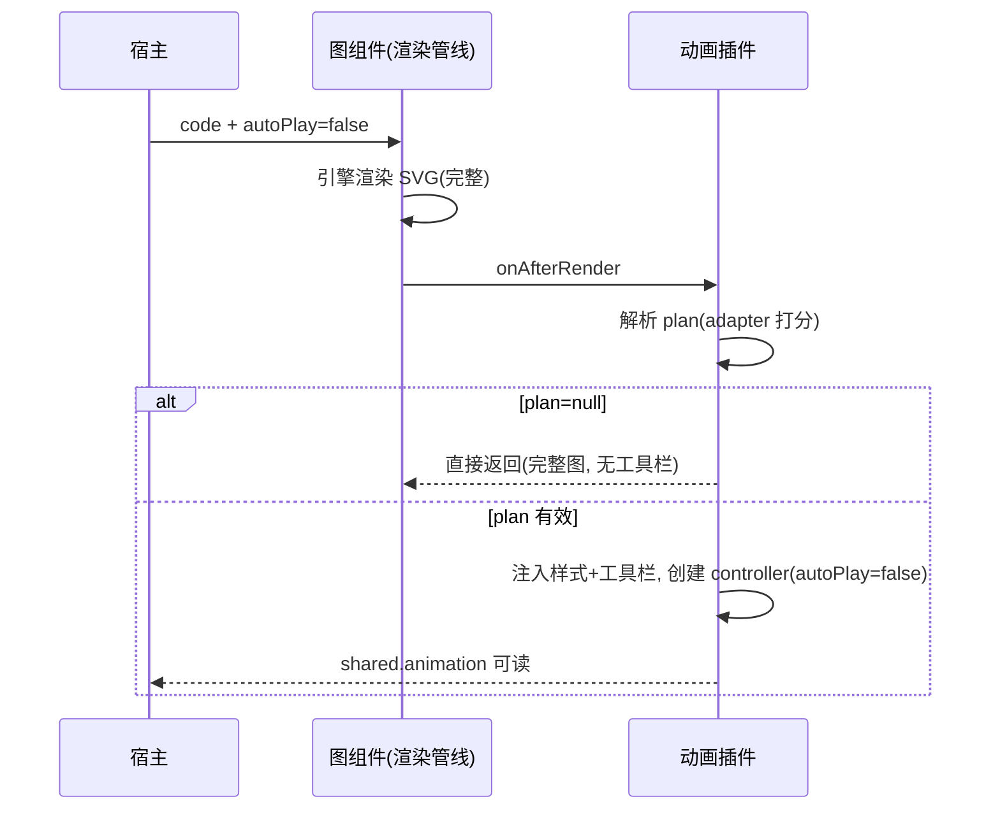
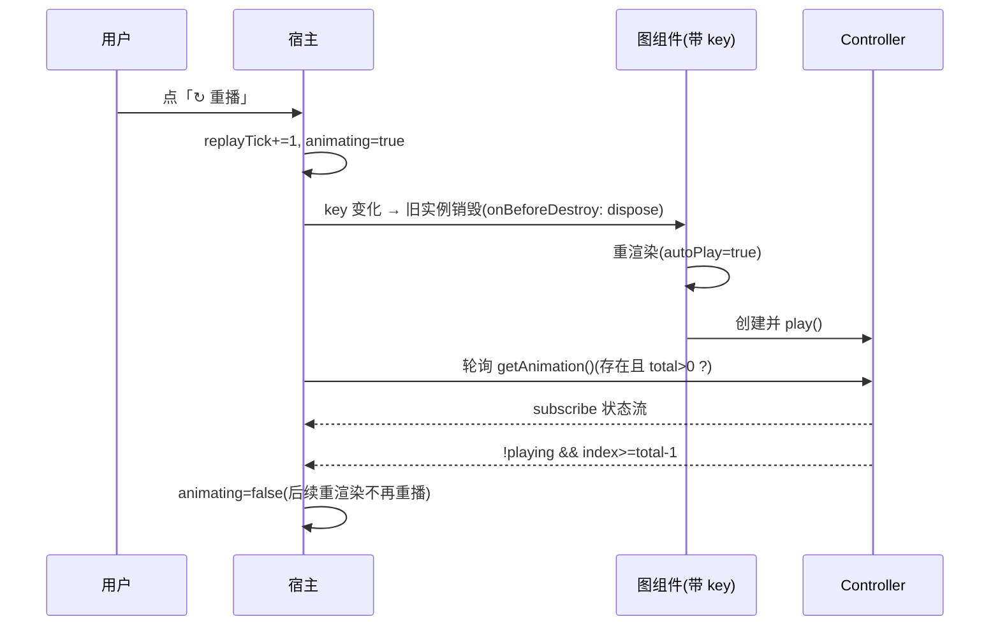

# 图示构建动画设计方案（Diagram Build-up Animation）

> 状态：设计参考文档（实现级）。
> 目标读者：需要在自有项目中实现「图示分步呈现」能力的前端工程师。
> 本文档与任何具体项目源码解耦：所有接口签名、算法与流程均为可直接照抄实现的设计资产。

---

## 1. 概述

### 1.1 解决什么问题

现代图示渲染管线（mermaid / plantuml / Graphviz / 自绘引擎）通常**一次性吐出完整 SVG**。
直接展示存在两个体验问题：

- 图示复杂时（几十个节点+边），观众不知道从哪里看起；
- 讲解/演示场景需要「按构建顺序逐步出现」的叙事感，静态图无法承载。

本方案在**不侵入渲染引擎**的前提下，为渲染产物（SVG）叠加一层
**分步构建动画**：将图中元素按某种语义顺序（文档序、源码行序、时序消息序…）
切成若干「步」，播放时逐步显现（reveal）或逐步高亮（highlight）。

### 1.2 核心设计原则

| 原则 | 落地方式 |
|---|---|
| 零渲染耦合 | 只操作引擎产出的 DOM（class 增删），不碰引擎内部状态 |
| 引擎无关 | 计划层按 `(引擎, 图类型)` 打分选策略，新引擎只加 adapter |
| 可完全复原 | dispose 时移除全部注入 class/监听/定时器，图回到初始完整态 |
| 默认不干扰 | 加载即完整图；动画是**显式行为**（点重播/显式开启 autoPlay） |
| 失败静默降级 | 无可用策略（plan 为 null）→ 图本身就是完整态，仅无动画 |

---

## 2. 总体架构

```
┌─────────────────────────────────────────────────────────────┐
│ 宿主编播层 Host Orchestrator                                  │
│  决定「何时播」: 默认完整呈现 / 重播按钮 / 播完熄灭 / 类型兜底   │
└──────────────△──────────────────────────────────────────────┘
               │ getAnimation() / subscribe(播放状态)
┌──────────────┴──────────────────────────────────────────────┐
│ 插件层 Plugin（挂进图渲染生命周期）                            │
│  onAfterRender: 解析 plan → 创建 controller → 注入工具栏/样式  │
│  onBeforeDestroy: dispose + 清理 DOM                          │
└──────────────△──────────────────────────────────────────────┘
               │ AnimationPlan
┌──────────────┴──────────────────────────────────────────────┐
│ 控制层 Controller（纯状态机，不认识任何图引擎）                 │
│  index 状态机 + 定时驱动 + class 切换 + 订阅通知               │
└──────────────△──────────────────────────────────────────────┘
               │ steps: [{label, elements}]
┌──────────────┴──────────────────────────────────────────────┐
│ 计划层 Adapters（唯一认识图引擎的一层）                        │
│  从渲染完成的 SVG 推导分步计划; 按 (engine,type) 打分解析       │
└─────────────────────────────────────────────────────────────┘
```

依赖方向严格自上而下：宿主只依赖 controller 接口；controller 只依赖
`AnimationPlan`；adapter 只依赖渲染产物 DOM。任何一层可独立替换。

---

## 3. 核心数据契约

实现级签名（TypeScript，语言无关概念）：

```ts
/** 播放模式: reveal=逐层显现(≤index 的可见) / highlight=逐层高亮(仅 index 激活) */
type AnimationMode = 'reveal' | 'highlight'

/** 一步 = 一组同时出现的元素 + 讲解标签(可用于字幕/进度提示) */
interface AnimationStep {
  label: string
  elements: Element[]        // 渲染产物 SVG 内的真实 DOM 元素
}

interface AnimationPlan {
  mode: AnimationMode
  steps: AnimationStep[]
  stepMs?: number            // 该计划的默认步长(可被创建参数覆盖)
}

/** adapter = 「某引擎某图类型」的分步策略 */
interface AnimationAdapter {
  engine: string             // 引擎标识, 'any' 通配
  type: string               // 图类型(flowchart/sequence/gantt/…), 'any' 通配
  build(svg: SVGSVGElement, code: string): AnimationPlan | null  // null=不支持
}

/** 播放状态(订阅回调载荷) */
interface AnimationState {
  index: number              // -1 = 重置态(reveal: 全隐藏; highlight: 无激活)
  playing: boolean
}

interface AnimationController {
  readonly mode: AnimationMode
  readonly total: number
  get index(): number
  get playing(): boolean
  play(): void               // 播到末尾后再 play = 从头重播
  pause(): void
  stop(): void               // 暂停并回到 -1
  next(): void / prev(): void
  seek(i: number): void      // 任意跳步(含 -1)
  setSpeed(multiplier: number): void
  subscribe(cb: (s: AnimationState) => void): () => void  // 返回退订函数
  dispose(): void            // 移除全部注入 class, 清定时器/监听
}
```

约定：`AnimationStep.elements` 引用的必须是渲染产物中的**真实节点**；
plan 为空（steps 合计 0）等价于「不支持动画」，调用方应静默跳过。

---

## 4. 功能细化

### 4.1 计划层：adapter 注册表与打分解析

注册表按优先级排列，解析时打分取最高：

```
score(adapter, engine, type):
    s = 0
    adapter.engine === engine      → s += 2
    否则 adapter.engine !== 'any'  → return 不合格(-1)
    adapter.type   === type        → s += 2
    否则 adapter.type !== 'any'    → return 不合格(-1)
    return s

resolve(engine, type):
    取 score 最高者; 最高分为 0(全 'any' 通配兜底也缺席) → null(无动画)
```

| 场景 | 命中 | 示例得分 |
|---|---|---|
| 精确 (mermaid, sequence) | 专用时序 adapter | 4 |
| 引擎通用 (mermaid, 其他类型) | mermaid generic | 2 |
| 类型通用 (其他引擎, sequence) | sequence generic(若声明 any 引擎) | 2 |
| 全兜底 ('any','any') | generic | 0 |

### 4.2 计划层：内置策略参考

| 策略 | 分步依据 | 步长 | 备注 |
|---|---|---|---|
| mermaid 通用 | SVG 内所有**带 id 的元素**按**文档序**每元素一步 | 300ms | 超 60 步封顶：最后一步把剩余元素打包为 `rest`（避免长图播放过久） |
| plantuml 通用 | 所有带 `data-source-line` 的形状**按源码行号升序**分组 | 450ms | 源码书写序≈自顶向下构建序，天然的叙事顺序；引擎需在产物上标注源行号 |
| 时序图专用 | 按消息序（ participant → 逐条消息 → 回执） | — | 顺序即语义 |
| 甘特图专用 | 按任务分段/时间轴推进 | — | 顺序即语义 |

> 要点：分步依据必须来自**渲染产物上可寻址的稳定特征**（id / 数据属性 /
> 结构顺序），而不是重新解析 DSL——后者会与引擎版本耦合。

### 4.3 计划层：两条自定义逃生通道

优先级（高→低）：**plan 工厂 > selector steps > 内置 adapter**。

```ts
// ① selector steps: 声明式, 每步一组 CSS 选择器(在渲染 SVG 内 querySelectorAll)
const steps = [
  { label: '数据源', selectors: ['#ds-a', '#ds-b'] },
  { label: '处理层', selectors: ['.node-proc'] },
]
// ② plan 工厂: 完全编程控制, 返回精确 plan; 返回 null = 本图不动画
const plan = (ctx: { svg, code, engine, type }) => myCustomPlan(ctx)
```

selector 步骤解析后 elements 为空（选择器全落空）的计划视为无效（null）。

### 4.4 控制层：状态机与驱动

- `index ∈ [-1, total-1]`，初始 `-1`；
- 驱动：`setTimeout` 链（不用 rAF——步长数百 ms，无需逐帧）；
- 步长解析链：`创建参数.stepMs ?? plan.stepMs ?? 600(ms)`，再除以倍速；
- 每步 `apply()` + `emit()`，订阅者同步 UI（进度 `index/total`、按钮态）。

**class 切换矩阵**（`apply()` 的全部逻辑）：

| 模式 | 条件 | 效果类 |
|---|---|---|
| reveal | `i > index` | `td-anim-hidden`（未播到的步隐藏） |
| reveal | `i <= index` | 无类（已播到的步显现） |
| highlight | `i === index` | `td-anim-active`（仅当前步高亮） |
| highlight | `i !== index` | 无类 |

边界语义：
- `play()` 在末尾再调用 → 自动回到 -1 重播；
- `pause/stop/next/prev/seek` 一律先清定时器（防定时器竞态双跳）；
- `dispose()`：清定时器、清监听、**移除所有元素上的全部注入 class**（图复原）。

### 4.5 插件层：渲染生命周期挂点

插件实现两个钩子，接入图组件的渲染管线：

- `onAfterRender(ctx)`：
  1. 按优先级解析 plan（工厂 > steps > adapter）；
  2. plan 为 null → 直接返回（图已是完整态）；
  3. 注入样式单例（见 §6）；
  4. `createAnimationController`（`autoPlay` 由宿主传入）；
  5. controller 发布到共享状态（如 `ctx.shared.animation`），宿主经组件 ref 读取；
  6. 组装图内浮动工具栏：`⏮ 重置 / ▶⏸ 播放暂停 / ⏭ 单步 / index/total 进度`，
     订阅 controller 同步按钮文案与进度。
- `onBeforeDestroy(ctx)`：`controller?.dispose()`、清 shared 引用、移除工具栏节点。

---

## 5. 关键流程

### 5.1 流程一：默认完整呈现（不自动播）

宿主把 `autoPlay=false` 传给图组件 → 插件仍创建 controller 与工具栏，
但 apply 后**立即停在最末步等效态**（reveal 模式 index=-1 时全隐藏，因此
默认态必须让图完整可见——实现上：默认不动画时**不创建** controller，
或创建后立即 `seek(total-1)`）。推荐前者：不支持/未请求动画时零开销。



### 5.2 流程二：按需重播编排（宿主核心流程）

关键机制：**key 重挂载**。宿主用「播放代号」参与组件 key，点重播时递增代号 →
组件整体卸载重建 → 以 `autoPlay=true` 重渲染 → 播放完成后宿主把动画态熄灭，
之后的主题/语言/全屏等重渲染不再重播。



> 为什么重挂载而非原位重播：主题/全屏等重渲染会替换 SVG DOM，原位重播
> 需要全量重新寻址元素；key 重挂载让「渲染→建 plan→播」走同一条已验证
> 路径，宿主只需一个递增整数。代价是一次重渲染成本，图渲染本身幂等。

### 5.3 流程三：不支持类型的兜底（轮询放弃）

`onReady` 后宿主轮询 `getAnimation()`（建议 100ms 间隔、上限 ~20 次）：

- 拿到 controller 且 `total>0` → 订阅监听播完；
- 超时拿不到（该类型无 adapter / plan 为 null）→ 放弃并复位动画态。
  图本身已是完整态，**仅无动画，零错误**。

### 5.4 流程四：销毁清理

组件卸载 → 插件 `onBeforeDestroy` → `dispose()`：清定时器 → 清订阅 →
遍历 plan 涉及元素移除全部注入 class（元素可能已随 DOM 销毁，需判空）→
移除工具栏。任何残留 class 都会在下次渲染造成「鬼影隐藏」。

---

## 6. CSS 契约

动画的全部视觉 = **3 个约定类 + 1 条 transition**，由插件注入全局单例
（按 id 去重，防止多图实例重复注入）：

```css
.td-anim-el      { transition: opacity 0.25s ease; }   /* 所有参与动画的元素 */
.td-anim-hidden  { opacity: 0 !important; pointer-events: none; }  /* 未播到 */
.td-anim-active  { filter: drop-shadow(0 0 4px <主题强调色>); }    /* highlight 当前步 */
```

设计取舍——**class 切换而非 JS 逐帧动画**：

1. 引擎产物常带内联样式与高特异性主题样式，`!important` + 类切换是唯一
   稳定压过它们的手段；
2. opacity/filter 是合成器友好属性，transition 交给浏览器即可，无 rAF 循环；
3. 复原 = 移除类，天然幂等， dispose 语义简单；
4. `pointer-events:none` 顺带封禁隐藏元素的交互（reveal 未播到不可点）。

---

## 7. 接入指南

### 7.1 最小集成面

一个新项目接入只需三件事：

1. **1 个插件**：把 §4.5 的两个钩子挂进自有图组件的渲染生命周期；
   没有生命周期钩子就把「渲染完成」作为事件/回调暴露。
2. **1 个控制器**：§4.4 状态机原样实现（约 150 行，零依赖）。
3. **N 个 adapter**：至少一个 `(any, any)` 兜底 generic（文档序逐元素即可）。

宿主侧约定：图组件暴露 `getAnimation()`（读 shared 状态）+ `autoPlay` 入参 +
`ready` 事件；重播走 key 重挂载（§5.2）。

### 7.2 新写一个 adapter 的清单

1. 声明 `engine/type`（能精确则精确，通配用 `'any'`）；
2. 在 `build(svg, code)` 中用**产物上的稳定特征**选元素（id / data-* / 结构序）；
3. 产出 steps（注意元素数量 < 2 时返回 null——单元素无动画意义）；
4. 设定合适 stepMs（信息密度高 → 更短）；总步数上限 60，超出合并尾部为 `rest`；
5. 为 label 生成可读文本（源行号 / 首行文本 / 消息内容），供进度字幕使用；
6. 单测：给定 fixture SVG，断言 plan 的步数与每步元素数。

---

## 8. 坑与裁决记录

| # | 坑 / 裁决 | 结论 |
|---|---|---|
| 1 | 主题/全屏切换会重渲染并替换 SVG DOM | 重播走 **key 重挂载**，不原位重播（§5.2） |
| 2 | 默认加载要不要播 | **不播**。动画是显式行为；编辑/调试场景反复重播是灾难 |
| 3 | 播完状态如何熄灭 | 订阅 `!playing && index>=total-1` 回调宿主复位，杜绝后续重渲染意外重播 |
| 4 | 步数失控（大图几百元素） | MAX_STEPS 封顶 + 尾部 `rest` 打包；步长与信息密度成反比 |
| 5 | 引擎内联样式压过动画类 | `!important` + class 切换；动画样式与主题样式分层（动画只碰 opacity/filter） |
| 6 | 隐藏元素仍可交互 | `td-anim-hidden` 同时置 `pointer-events:none` |
| 7 | 标签文本寻址（HTML 标签混排） | 引擎可能把文本放进 foreignObject/HTML：寻址兜底要同时覆盖 SVG `<text>` 与 HTML 元素的 `textContent`；跨代 ID 可能带实例前缀，需剥前缀再匹配 |
| 8 | 定时器竞态 | pause/stop/next/prev/seek 全部先 clearTimeout；dispose 后 tick 直接 return |
| 9 | 销毁残留 | dispose 必须移除全部注入 class（判元素是否仍存活），否则下次渲染鬼影 |
| 10 | plan 缺失类型 | resolve 返回 null 时一切照旧（完整图 + 无工具栏），静默降级不报错 |
